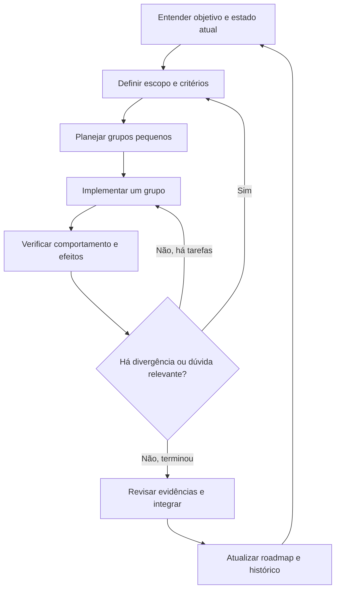

# 3. Ciclo de trabalho: da ideia à entrega

[Índice](README.md) · Anterior: [Artefatos](02-artefatos-e-organizacao.md) · Próximo: [Projetos novos](04-projetos-novos.md)

## Etapa 1 — Reconhecer o contexto

Leia missão, decisões técnicas, roadmap e a área de código afetada. Confira o estado de trabalho e as regras do repositório. Em legado, estabeleça a baseline antes de modificar comportamento.

Selecione uma fase pendente cujas dependências estejam satisfeitas. Se uma fase já começou, avalie retomá-la antes de abrir outra. A primeira fase totalmente desmarcada nem sempre é a próxima prioridade real.

**Saída:** problema, público, resultado desejado, restrições conhecidas e questões abertas.

## Etapa 2 — Fazer perguntas que alteram a solução

O curso agrupa a entrevista em escopo, decisões e contexto. Você pode usar essas três perspectivas em conversa, issue ou formulário:

| Perspectiva | Perguntas úteis |
|---|---|
| Escopo | Quem realiza a ação? Quais entradas e saídas? O que fica fora? |
| Decisões | O que acontece em conflito? Há persistência? Quem pode acessar? |
| Contexto | Existe contrato antigo? Prazo? Convenções? Dependência externa? |

Não transforme a entrevista em repetição de fatos já presentes no repositório. Traga o que encontrou e destaque o que depende de decisão de produto. Uma dúvida sobre autenticação, perda de dados ou compatibilidade pode impedir a implementação dependente; uma escolha local de nome de função normalmente não impede.

**Saída:** dúvidas resolvidas ou explicitamente classificadas como bloqueadoras/não bloqueadoras, com responsável.

## Etapa 3 — Escrever requisitos e validação juntos

Defina primeiro o comportamento observável e, para cada regra, pergunte como verificá-la. Inclua caminho feliz, rejeições, limites e efeitos persistidos. Documente atributos de qualidade relevantes com cenário e medida, quando aplicável.

“Rápido” precisa de carga, ambiente e limite acordados para ser testável. “Acessível” precisa de verificações concretas adequadas à interface. Não preencha metas arbitrárias somente porque o template tem uma seção.

**Saída:** `requirements.md` e critérios iniciais em `validation.md`, ainda sem alegar execução.

## Etapa 4 — Planejar grupos de implementação

Cada grupo precisa de objetivo, dependências e verificação. Uma sequência possível é: contrato e dados → regra de negócio → interface → integração → validação final. Outra pode começar por teste de caracterização ou investigação. A ordem depende do risco.

Grupos devem ser pequenos e revisáveis; nem sempre podem ser executados em paralelo. Uma interface que depende de um contrato ainda indefinido precisa esperar a definição ou usar um contrato explicitamente acordado.

**Saída:** `plan.md` com tarefas relacionadas aos requisitos e um primeiro grupo executável.

## Etapa 5 — Revisar a prontidão

- [ ] O objetivo e o que fica fora estão claros.
- [ ] Há exemplos suficientes para as regras críticas.
- [ ] As dependências e os contratos afetados foram identificados.
- [ ] Cada requisito tem verificação prevista.
- [ ] Comandos necessários foram confirmados ou sua preparação está no plano.
- [ ] Dúvidas bloqueadoras estão resolvidas antes do trabalho que depende delas.

Use revisão humana quando a equipe ou a decisão exigir. Uma especificação pode estar pronta para investigação sem estar pronta para implementação definitiva; declare essa diferença.

## Etapa 6 — Implementar e aprender

Implemente um grupo, execute as verificações pertinentes e examine o diff. Se surgir uma regra não prevista, atualize a especificação antes de expandir o comportamento. Se encontrar problema independente, registre no backlog com impacto e evite incorporá-lo automaticamente à entrega.

Atualize tarefas com honestidade: “implementada, validação pendente” é diferente de “concluída”. Preserve mudanças de outras pessoas e siga a estratégia de branches do projeto. SDD não exige uma estratégia Git específica.

## Etapa 7 — Validar e revisar

Execute os cenários acordados na revisão final relevante. Registre comandos, contexto, resultados e limitações. Revise o comportamento, o código e a coerência da documentação. Testes de implementação não substituem revisão do contrato, e revisão visual não comprova integridade de dados.

Para uma falha, escolha entre corrigir, revisar uma expectativa incorreta com justificativa ou registrar um bloqueio. Não reescreva um critério para aceitar o resultado atual sem decisão explícita sobre o novo comportamento.

## Etapa 8 — Integrar e preparar a próxima fase

Confira que a entrega atende aos critérios, atualize roadmap e changelog e siga o processo de integração da equipe. Se houver publicação, execute o plano operacional correspondente. Integrar código e publicar em produção são eventos diferentes.

**Checklist de encerramento:** requisitos atendidos; evidências registradas; regressões examinadas; documentação coerente; pendências encaminhadas; rollout aplicável preparado; estado final claro para a próxima pessoa.

## Quando replanejar

Replaneje quando uma premissa falhar, surgir dependência impeditiva, mudar a prioridade ou a entrega ficar grande demais. Registre o motivo, quais requisitos mudaram, o destino das tarefas e o que precisa ser revalidado. Preserve o vínculo entre o trabalho parcial e a nova fase.
